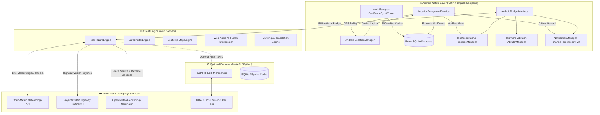
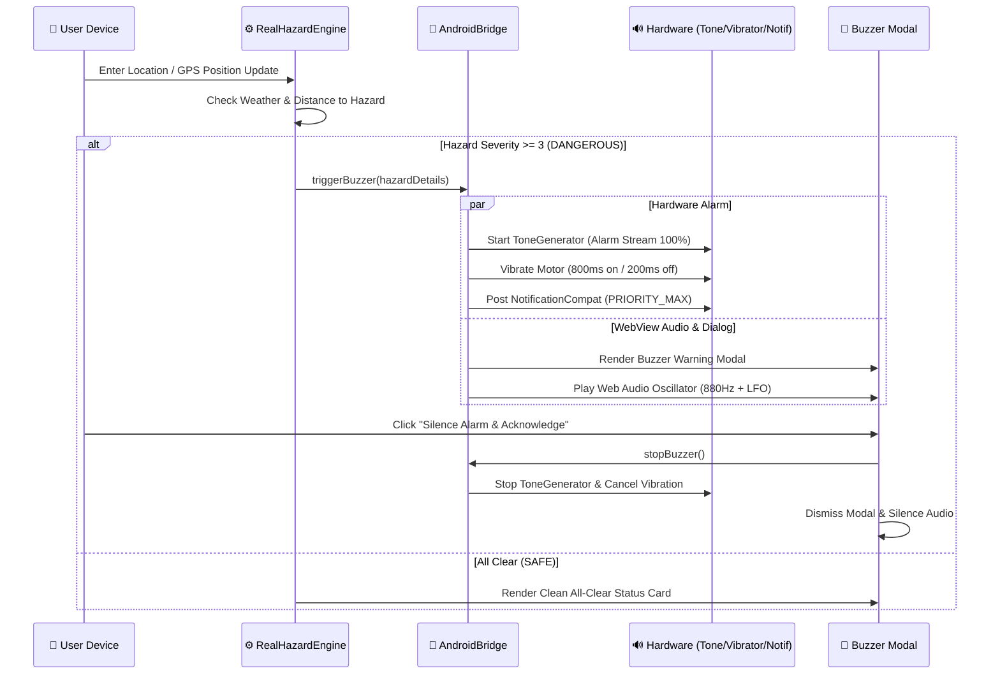
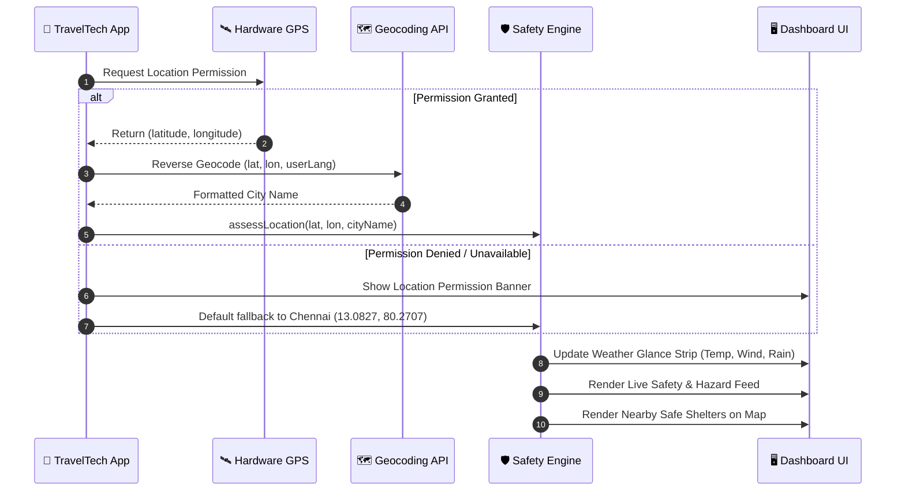
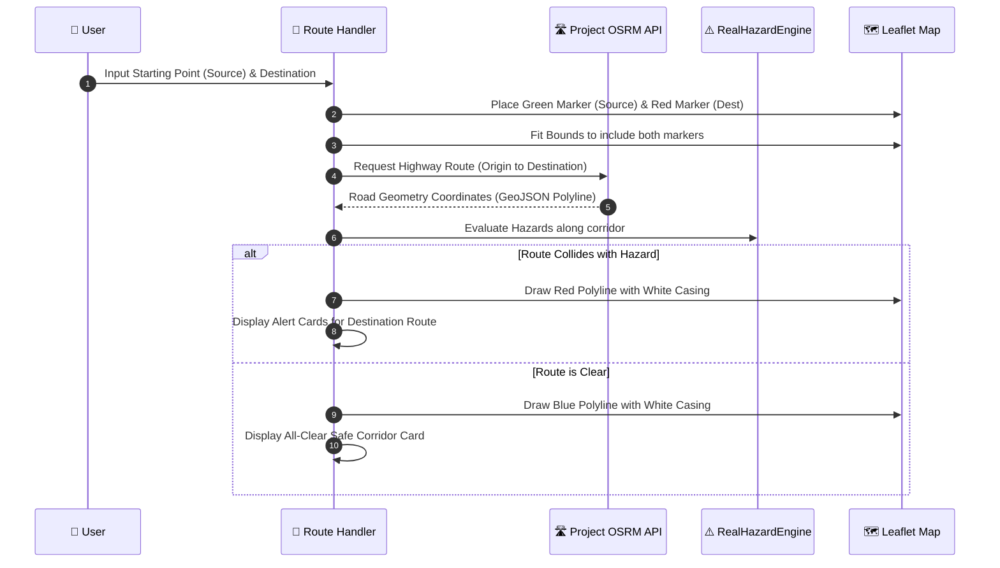

# 🌍 TravelTech — Crisis Safety & Highway Route Navigation

[](https://developer.android.com/)
[](LICENSE)
[](#-zero-apk-weight--proactive-geofence-syncing)
[](#-native-multilingual-engine-14-languages)
[](https://project-osrm.org/)
[](https://open-meteo.com/)

**TravelTech** is a real-time, proactive crisis safety radar, highway evacuation planner, and disaster mitigation platform. Designed for travelers, motorists, and disaster relief workers facing extreme natural disasters—such as cyclones, flash floods, squall storms, gale-force winds, and extreme heatwaves.

TravelTech operates as an **autonomous, zero-server-dependent Android APK** with on-device risk assessment, hardware siren alerts, offline caching, and native background location monitoring.

---

## 📑 Table of Contents
- [Architecture & System Design](#-architecture--system-design)
- [Key Features](#-key-features)
  - [1. Current Location Safety Radar](#1-current-location-safety-radar)
  - [2. Destination Route Highway Navigation](#2-destination-route-highway-navigation)
  - [3. Dynamic Safe Shelters Finder](#3-dynamic-safe-shelters-finder)
  - [4. Emergency Buzzer Siren & Offline Push Notifications](#4-emergency-buzzer-siren--offline-push-notifications)
  - [5. Zero APK Weight & Proactive Geofence Syncing](#5-zero-apk-weight--proactive-geofence-syncing)
  - [6. Native Multilingual Engine (14 Languages)](#6-native-multilingual-engine-14-languages)
  - [7. Responsive Adaptive UI/UX](#7-responsive-adaptive-ui-ux)
- [Tech Stack](#-tech-stack)
- [Core Logic Implementation](#-core-logic-implementation)
  - [Haversine Distance & Geodesic Proximity](#haversine-distance--geodesic-proximity)
  - [Meteorological Hazard Classification Rules](#meteorological-hazard-classification-rules)
  - [Time Horizon & Active-Only Hazard Filtering](#time-horizon--active-only-hazard-filtering)
  - [Emergency Buzzer & Offline Notification Pipeline](#emergency-buzzer--offline-notification-pipeline)
  - [Shelter Distance Sorting & Land Geofencing](#shelter-distance-sorting--land-geofencing)
- [Workflows & Sequence Diagrams](#-workflows--sequence-diagrams)
- [APIs & Data Providers](#-apis--data-providers)
- [Verification & Testing Guide](#-verification--testing-guide)
- [Project Directory Structure](#-project-directory-structure)
- [Installation & Build Guide](#-installation--build-guide)

---

## 🏛 Architecture & System Design

TravelTech uses a **hybrid edge architecture**: a native Kotlin/Jetpack Compose Android container hosting an embedded web engine, backed by an `@JavascriptInterface` Android hardware bridge and native background services.



---

## 🌟 Key Features

### 1. Current Location Safety Radar
* **Live Environmental Glance Strip:** Real-time temperature (°C), peak wind gusts (km/h), and precipitation volume (mm).
* **Time-Horizon Selection:** Switch between **Today**, **1 Week**, and **2 Weeks** forecasts.
* **Strict Active-Only Filtering:** Past or resolved disasters are automatically filtered out using ISO-8601 timestamps; only ongoing hazards and future warnings are displayed.
* **One-Tap GPS Restoration:** A dedicated **"📍 My GPS"** button re-queries live GPS hardware, reverse-geocodes your actual city, refreshes nearby shelters, and recenters the map.
* **Manual City Override:** Users can change locations using an autocomplete search dialog or quick selection chips.

### 2. Destination Route Highway Navigation
* **Dual-Point Highway Routing:** Starting Point (Source) and Destination can be selected independently without altering the user's primary GPS monitoring location.
* **Distinct Visual Markers:**
  * 🚩 **Starting Point:** Custom green pin with popup details.
  * 🎯 **Destination:** Custom red pin with popup details.
* **Real Road Geometries (OSRM):** Routes follow highways and roads rather than straight lines.
* **High-Visibility Route Casings:** Dual-layer polyline rendering with a white highway contrast border and color-coded status line:
  * 🔵 **Blue Polyline:** Safe highway corridor.
  * 🔴 **Red Polyline:** Path collides with severe disaster zones.
* **Corridor Hazard Feed:** Evaluates both destination hazards and departure point conditions simultaneously.

### 3. Dynamic Safe Shelters Finder
* **Verified Inland Shelter Database:** All emergency shelter coordinates are verified land-based locations (community centers, reinforced schools, stadiums).
* **Live Proximity Sorting:** Automatically computes driving and walking distance (in km) to all shelters using the Haversine algorithm from the user's current GPS position.
* **Emergency Hotline Calling:** One-tap `tel:` dialer integration allows instant phone calls to on-duty shelter coordinators.
* **Visual Map Indicators:** Displays pulsing green shield pins (`🛡️`) with interactive popup cards detailing capacity, operational status, and hotlines.
* **Buzzer Navigation Action:** The emergency buzzer dialog includes a direct button to plot an immediate route to the closest shelter.

### 4. Emergency Buzzer Siren & Offline Push Notifications
* **Multi-Channel Warning System:**
  1. 🔊 **Audible Alarm:** Emits emergency frequencies using Android's `ToneGenerator` (`TONE_CDMA_EMERGENCY_RINGBACK` on `STREAM_ALARM` at maximum volume) and an on-device dual-tone Web Audio API synthesizer (880 Hz modulated with a 240 Hz LFO).
  2. 📳 **Hardware Vibration:** Pulses the phone's vibration motor (`800ms pulse, 200ms pause`).
  3. 📲 **Heads-Up Notifications:** Fires high-priority Android notifications through a dedicated emergency channel (`channel_emergency_v2`).
  4. 🚨 **Fullscreen Dialog:** A high-contrast modal shows hazard details and the nearest safe shelter.
* **Alert Deduplication:** Once triggered for a specific coordinate, alerts will not repeatedly ring until the user leaves the danger zone and enters another area.

### 5. Zero APK Weight & Proactive Geofence Syncing
* **0 KB Base App Footprint:** Ships with zero bloated offline databases bundled into the APK.
* **Background Sync via WorkManager:** When internet connectivity is active, `GeoFenceSyncWorker` silently caches a lightweight JSON tile covering a 100 km radius of the user's GPS position.
* **Disaster-Ready Offline Fallback:** If cellular towers fail during a cyclone or flood, TravelTech evaluates safety and shelters entirely from local Room and `localStorage` caches.

### 6. Native Multilingual Engine (14 Languages)
Full runtime translation for all interface labels, weather descriptions, and alert advisories across 14 languages:
* 🇬🇧 English (`en`)
* 🇮🇳 தமிழ் / Tamil (`ta`)
* 🇮🇳 हिन्दी / Hindi (`hi`)
* 🇮🇳 తెలుగు / Telugu (`te`)
* 🇮🇳 ಕನ್ನಡ / Kannada (`kn`)
* 🇮🇳 മലയാളം / Malayalam (`ml`)
* 🇮🇳 मराठी / Marathi (`mr`)
* 🇮🇳 বাংলা / Bengali (`bn`)
* 🇪🇸 Español / Spanish (`es`)
* 🇫🇷 Français / French (`fr`)
* 🇩🇪 Deutsch / German (`de`)
* 🇯🇵 日本語 / Japanese (`ja`)
* 🇨🇳 简体中文 / Simplified Chinese (`zh`)
* 🇸🇦 العربية / Arabic (`ar` with RTL layout support)

Language preferences persist across sessions via `localStorage`.

### 7. Responsive Adaptive UI/UX
* **Flexible Layout Engine:** Adapts cleanly to all screen sizes, tablets, and orientations (vertical portrait or horizontal landscape).
* **Segmented Navigation:** Tab-based switching between **Current Location**, **Destination Route**, and **Safe Shelters**.
* **Collapsible Map:** Live Leaflet map stays tucked at the bottom and can be opened, closed, or recentered with one tap.

---

## 🛠 Tech Stack

### Mobile & Android Native
| Component | Technology | Description |
|---|---|---|
| **Language** | Kotlin 1.9+ / Java 17 | Core Android codebase |
| **UI Framework** | Jetpack Compose & Material 3 | Modern Android declarative UI |
| **Web Container** | Android `WebView` & `WebChromeClient` | High-performance HTML5 rendering engine |
| **Hardware Bridge** | `@JavascriptInterface` (`AndroidBridge`) | Bridges JS to Android Audio, Vibration & Notifications |
| **Background Service** | `LocationForegroundService` | Persistent GPS watchdog for background alerts |
| **Offline Sync** | Android `WorkManager` (`GeoFenceSyncWorker`) | Background predictive 100 km tile geofence caching |
| **Local Database** | Room Database (SQLite) | On-device persistence for shelters & hazard entities |
| **Dependency Injection** | Dagger / Hilt | Injects Repositories, DAOs, and API services |

### Frontend & Embedded Web Engine
| Component | Technology | Description |
|---|---|---|
| **Core Architecture** | Vanilla ES6+ JavaScript, HTML5, CSS3 | Zero framework overhead, instant startup |
| **Mapping Engine** | Leaflet.js v1.9.4 & OpenStreetMap Tiles | Interactive map, custom DivIcons, vector overlays |
| **Audio Synthesizer** | Web Audio API | Dual-tone emergency siren frequency synthesis |
| **Design System** | Custom CSS Variables, Flexbox, Glassmorphism | Dark/Light crisis safety themes, Plus Jakarta Sans typography |
| **Offline Cache** | HTML5 `localStorage` & Cache Storage | Caches shelters, last weather state, and hazard bounds |

### Geospatial & Meteorological APIs
| Service | Provider | Purpose |
|---|---|---|
| **Weather & Radar** | [Open-Meteo](https://open-meteo.com/) | Live temperature, wind gusts, precipitation, WMO codes |
| **Road Routing** | [Project OSRM](https://project-osrm.org/) | Highway and street navigation geometries (GeoJSON) |
| **Geocoding** | Open-Meteo Geocoding & OSM Nominatim | Place autocomplete, address search, reverse geocoding |
| **Global Disasters** | [GDACS](https://www.gdacs.org/) | Worldwide disaster feeds (cyclones, quakes, floods) |

### Optional Backend Microservice (`/backend`)
| Component | Technology | Description |
|---|---|---|
| **Web Framework** | FastAPI (Python 3.10+) | Async high-concurrency REST API |
| **ASGI Server** | Uvicorn | High-throughput web server |
| **ORM & Database** | SQLAlchemy / SQLite (`traveltech.db`) | Stores hazard polygons and shelter directories |
| **Background Jobs** | APScheduler | Periodic ingestion of GDACS RSS & weather forecasts |

---

## 🧠 Core Logic Implementation

### Haversine Distance & Geodesic Proximity
Proximity calculations between the user's position `(lat1, lon1)` and hazard centers or shelters `(lat2, lon2)` use the spherical Haversine formula:

$$\Delta\text{lat} = \text{lat}_2 - \text{lat}_1, \quad \Delta\text{lon} = \text{lon}_2 - \text{lon}_1$$

$$a = \sin^2\left(\frac{\Delta\text{lat}}{2}\right) + \cos(\text{lat}_1)\cos(\text{lat}_2)\sin^2\left(\frac{\Delta\text{lon}}{2}\right)$$

$$c = 2 \cdot \text{atan2}\left(\sqrt{a}, \sqrt{1 - a}\right), \quad d = R \cdot c \quad (R = 6371\text{ km})$$

Implemented in both Kotlin (`SafetyEngine.kt`) and JavaScript (`web/index.html`).

---

### Meteorological Hazard Classification Rules
The `RealHazardEngine` applies standard World Meteorological Organization (WMO) criteria to compute danger levels:

| Condition / Metric | Threshold | Level | Severity | Advisory / Action |
|---|---|---|---|---|
| **WMO Code 96 / 99** | Thunderstorm with Hail | **DANGEROUS** | `3` | Seek reinforced shelter immediately. |
| **WMO Code 95 + Squall** | Gusts $\ge 65$ km/h or Precip $\ge 40$ mm/h | **DANGEROUS** | `3` | Squall storm. Evacuate open highways. |
| **WMO Code 95** | Standard Thunderstorm | **CAUTION** | `2` | Avoid open fields & tall metallic structures. |
| **Gale-Force Wind** | Wind Gusts $\ge 65$ km/h | **DANGEROUS** | `3` | High risk of flying debris & structural damage. |
| **High Wind Squalls** | Wind Gusts $\ge 55$ km/h | **CAUTION** | `2` | High-profile vehicles take caution. |
| **Violent Downpour** | Rain $\ge 35$ mm/h or WMO Code 82 | **DANGEROUS** | `3` | Flash flooding risk. Avoid underpasses. |
| **Heavy Rainfall** | Rain $\ge 20$ mm/h or WMO Code 65 | **CAUTION** | `2` | Waterlogging warning. Reduce driving speed. |
| **Extreme Heatwave** | Temperature $\ge 43^\circ\text{C}$ | **DANGEROUS** | `3` | Heatstroke risk. Stay hydrated in shade. |
| **Dense Fog** | WMO Code 45 or 48 | **CAUTION** | `2` | Severely restricted highway visibility. |

---

### Time Horizon & Active-Only Hazard Filtering
1. **Timestamp Check:** Evaluates current epoch against `end_time`:
   ```javascript
   const nowMs = Date.now();
   currentActiveHazards = currentActiveHazards.filter(h =>
     !h.end_time || new Date(h.end_time).getTime() >= nowMs
   );
   ```
2. **Forecast Window Slicing:**
   * **Today (`activeHorizon === 'today'`):** Forecast days limit set to `0`. Displays only live active hazards occurring right now.
   * **1 Week (`activeHorizon === '1'`):** Evaluates daily forecasts up to 7 days ahead.
   * **2 Weeks (`activeHorizon === '2'`):** Evaluates daily forecasts up to 14 days ahead.

---

### Emergency Buzzer & Offline Notification Pipeline


---

### Shelter Distance Sorting & Land Geofencing
1. For every shelter entity in `SafeShelterEngine`, calculate $d = \text{haversineDistKm}(u_{\text{lat}}, u_{\text{lon}}, s_{\text{lat}}, s_{\text{lon}})$.
2. Sort array ascending by $d$.
3. Pre-screened shelter database guarantees all shelter points reside strictly on land:
   * **Chennai:** Nehru Indoor Stadium, Anna University Pavillion, Ripon Building Relief Camp.
   * **Hyderabad:** Gachibowli Indoor Stadium, Kotla Vijay Bhaskar Reddy Indoor Stadium.
   * **Bengaluru:** Kanteerava Indoor Stadium, Koramangala Indoor Stadium.
   * **Mumbai:** National Sports Club of India (NSCI), Andheri Sports Complex.

---

## 🔄 Workflows & Sequence Diagrams

### 1. App Startup & Location Synchronization


### 2. Destination Route Planning & Corridor Assessment


---

## 🌐 APIs & Data Providers

### External Public APIs (Used Direct On-Device)

#### 1. Open-Meteo Meteorology Forecast API
* **Endpoint:** `GET https://api.open-meteo.com/v1/forecast`
* **Query Parameters:**
  * `latitude`, `longitude`: Decimal coordinates.
  * `current`: `temperature_2m,relative_humidity_2m,apparent_temperature,precipitation,rain,weather_code,wind_speed_10m,wind_gusts_10m`
  * `daily`: `weather_code,temperature_2m_max,temperature_2m_min,precipitation_sum,wind_gusts_10m_max`
  * `forecast_days`: `16`
  * `timezone`: `auto`
* **Authentication:** None (Completely Free & Open).

#### 2. Project OSRM Road Routing API
* **Endpoint:** `GET https://router.project-osrm.org/route/v1/driving/{fromLon},{fromLat};{toLon},{toLat}`
* **Query Parameters:**
  * `overview=full`
  * `geometries=geojson`
* **Output:** Returns full GeoJSON `coordinates` array tracing real asphalt road networks and highways.

#### 3. Open-Meteo Geocoding API
* **Endpoint:** `GET https://geocoding-api.open-meteo.com/v1/search`
* **Query Parameters:**
  * `name`: Search query string.
  * `count`: Maximum results (e.g., `5`).
  * `language`: Target locale code (e.g., `en`, `hi`, `ta`).

---

### Optional FastAPI Microservice Endpoints (`/backend`)

| Method | Endpoint | Description |
|---|---|---|
| `POST` | `/api/safety/check` | Evaluates safety risk for a given point and time horizon |
| `POST` | `/api/route/safe` | Computes safe evacuation routes avoiding disaster polygons |
| `GET` | `/api/shelters/nearby` | Queries verified emergency safe shelters around lat/lon |
| `GET` | `/api/hazards/nearby` | Returns active GDACS and weather hazard zones |
| `GET` | `/api/places/search` | Geocodes place queries with multilingual support |
| `GET` | `/api/places/reverse` | Reverse-geocodes coordinates into clean city/country names |
| `POST` | `/api/device/register` | Registers device for localized emergency broadcast sync |
| `POST` | `/api/device/location` | Ingests background location telemetry |

---

## 🧪 Verification & Testing Guide

You can verify the **emergency buzzer siren**, **vibration**, and **offline notifications** using either of the following methods:

### Method 1: Instant Verification Zone (100% Offline Anytime)
1. In the **Current Location** card, tap **"Change Location"**.
2. Type `Hazard Test` or `hazard` in the search bar.
3. Select **`⚠️ Hazard Test Zone (Buzzer & Offline Alert Test)`**.
4. **Immediate Results:**
   * 🔊 **Audio Siren:** Two-tone siren sounds from the speaker.
   * 📳 **Vibration:** Device vibrates in an emergency pulsing rhythm.
   * 📲 **Offline Notification:** An alert appears in the notification shade:
     > `🚨 Hazard Alert!`  
     > *CRITICAL EMERGENCY: Severe Cyclone & Gale Storm Hazard Zone (85 km/h wind gusts, torrential downpour)*
   * 🚨 **Modal Dialog:** Fullscreen warning displays with nearest shelter information and a direct route button.
   * Tap **"Silence Alarm & Acknowledge"** to dismiss.

### Method 2: Live Real-World Gale Storm Test
1. In **Change Location**, type **`Macquarie Island`**.
2. Select **`Macquarie Island (Active Gale Storm - 80 km/h)`**.
3. TravelTech queries live Open-Meteo radar for the coordinates `(-54.6208, 158.8556)`. Because current wind gusts exceed **65 km/h** (clocked at 80+ km/h), the app classifies the zone as **DANGEROUS (Severity 3)** and triggers the full siren, vibration, and push alert pipeline.

### Method 3: GPS Return Verification
1. After testing another city, tap **"📍 My GPS"** in the **Current Location** card or map toolbar.
2. The app resets manual locks, queries hardware GPS, updates Current Location to your actual city, refreshes local shelters, and leaves Destination Route starting points untouched.

---

## 📁 Project Directory Structure

```
travelTech/
├── TravelTech.apk                          # Pre-compiled standalone Android APK
├── README.md                               # Project documentation
│
├── android/                                # Android Native Project (Gradle)
│   ├── build.gradle.kts                    # Root build configuration
│   ├── gradlew.bat / gradlew               # Gradle wrapper binaries
│   └── app/
│       ├── build.gradle.kts                # App dependencies (Compose, Room, Hilt, WorkManager)
│       └── src/main/
│           ├── AndroidManifest.xml         # Permissions (GPS, Notifications, Background Service)
│           ├── java/com/traveltech/app/
│           │   ├── MainActivity.kt         # Jetpack Compose UI & AndroidBridge (@JavascriptInterface)
│           │   ├── AlertActivity.kt        # Standalone lock-screen emergency alert activity
│           │   ├── TravelTechApp.kt        # Application class (Hilt Android App)
│           │   ├── data/
│           │   │   ├── local/              # Room Database, HazardDao, ShelterDao, Entities
│           │   │   ├── remote/             # Retrofit ApiService & DTOs
│           │   │   └── repository/         # SafetyRepository (Offline Cache & Sync)
│           │   ├── service/
│           │   │   └── LocationForegroundService.kt # Background GPS Watchdog Service
│           │   ├── sync/
│           │   │   └── GeoFenceSyncWorker.kt # WorkManager background 100km tile syncer
│           │   └── util/
│           │       └── SafetyEngine.kt     # On-device Haversine hazard evaluator
│           └── assets/web/
│               └── index.html              # Embedded web application bundle
│
├── web/
│   └── index.html                          # Single-Page Web Application (HTML5 / ES6 / Leaflet)
│
└── backend/                                # Optional FastAPI Microservice
    ├── main.py                             # FastAPI application routes
    ├── safety_engine.py                    # Server-side safety assessment
    ├── route_engine.py                     # Safe corridor routing & OSRM proxy
    ├── shelter_service.py                  # Disaster relief shelter queries
    ├── weather_engine.py                   # Open-Meteo weather client
    ├── gdacs_ingest.py                     # GDACS disaster feed parser
    ├── models.py / schemas.py              # SQLAlchemy models & Pydantic schemas
    └── requirements.txt                    # Python dependencies
```

---

## 🚀 Installation & Build Guide

### 1. Direct APK Installation
To run TravelTech on an Android device (Android 8.0 Oreo or higher):
1. Transfer [`TravelTech.apk`](./TravelTech.apk) to your Android device.
2. Enable *"Install unknown apps"* in your Android Settings if prompted.
3. Open the APK file and tap **Install**.
4. Grant **Location** and **Notification** permissions when prompted.

---

### 2. Building the Android Project from Source
#### Prerequisites:
* Android Studio Hedgehog (2023.1.1) or newer.
* Android SDK 34 / Build Tools 34.0.0.
* Java Development Kit (JDK) 17 or higher.

#### Build Command (PowerShell):
```powershell
# Set Java Home to JDK 17 / JBR
$env:JAVA_HOME = "C:\Program Files\Android\Android Studio\jbr"

# Navigate to android directory and compile debug APK
cd android
./gradlew.bat assembleDebug

# Compiled APK will be generated at:
# android/app/build/outputs/apk/debug/app-debug.apk
```

---

### 3. Running the Optional FastAPI Backend
#### Prerequisites:
* Python 3.10 or higher.
* `pip` package manager.

#### Setup Commands:
```bash
cd backend

# Create and activate virtual environment
python -m venv venv
source venv/bin/activate  # On Windows: .\venv\Scripts\activate

# Install dependencies
pip install -r requirements.txt

# Start FastAPI server on port 8000
uvicorn main:app --host 0.0.0.0 --port 8000 --reload
```

---

## 📄 License
This project is licensed under the [MIT License](LICENSE) — free to use, modify, and distribute for disaster risk reduction and humanitarian safety.
