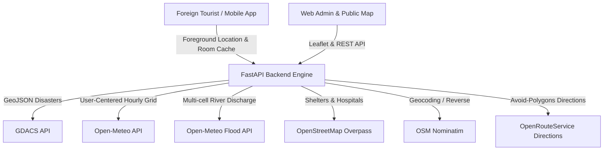

# TravelTech Crisis Communication

**TravelTech** is a 100% free, real-time crisis communication platform designed for foreign tourists and travelers during extreme weather events (flash floods, cyclones, storms, heatwaves).

---

## Architecture Overview

---

## Core Features

1. **User-Centered Hazard Ingestion (No Polygons in DB)**
   - All hazards are circular zones: `HazardZone(center_lat, center_lon, radius_km, severity, start_time, end_time)`.
   - Snapped to $0.1^\circ$ (~11 km) grid cells with 10-minute caching.
   - Strictly obeys the **ACTIVE-ONLY RULE** (`start_time <= now <= end_time`). Expired hazards are ignored and deleted by background cleaners.

2. **Feature 1: Hazardous Location Alerts**
   - High-accuracy GPS tracking with 5 km delta cache refresh.
   - On-device Room database Haversine evaluation works fully offline.
   - High-priority full-screen alert dialog with audio & vibration.
   - Deduplicated alerts with automatic **ALL CLEAR** when exiting danger.

3. **Feature 2: Destination Weather Warnings**
   - Live 3x3 grid refresh at searched destination.
   - Green/Amber/Red safety banners with barrier confirmation on dangerous destinations.

4. **Feature 3: Safe Route & Rerouting Engine**
   - 200m polyline densification.
   - Arrival-time aware hazard evaluation.
   - ORS Directions with 24-sided avoidance polygons fallback.
   - Decisions: `SAFE`, `REROUTED`, or `UNREACHABLE`.

5. **Multilingual & Offline Ready**
   - 15 languages: English, Hindi, Tamil, Telugu, Malayalam, Kannada, Bengali, Marathi, Gujarati, French, Spanish, German, Chinese, Japanese, and Arabic (with RTL support).
   - Emergency contacts with 3-second hold SOS triggering `ACTION_SENDTO` (SMS) and `ACTION_DIAL` (112 in India).
